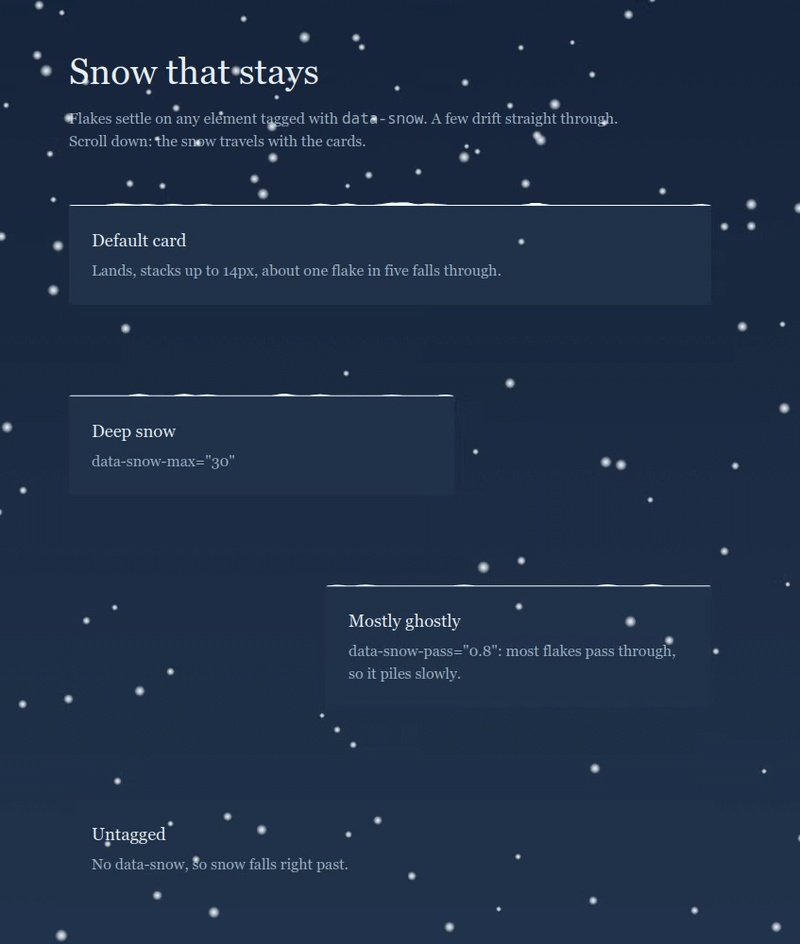

# websitesnow
simple JS snow simulator that snows all over your website.

*made by snow lover for snow lovers*



> [!NOTE]
> This been made by Claude AI, making it pretty sloppy.

## How do I apply it?

Simple as, download  into your website directory.

Apply this code to your webpage HTML file.

```
<script src="snow.js"></script>
<script>
  Snow.start();   // or leave out image for a soft round dot
</script>
```

*Boom*, it starts snowing.

To have snow land on *specific parts* of your webpage such as card, div, buttons, text, etc... Apply <ins>data-snow</ins> inside tag like this:

```
<div data-snow>...</div>
<div data-snow data-snow-max="30" data-snow-pass="0.5">...</div>
```

Now you have snow landing on your sweet div and it stacks.

> [!NOTE]
> You can change configuration in snow.js to change on what you would like to what snow would act.
